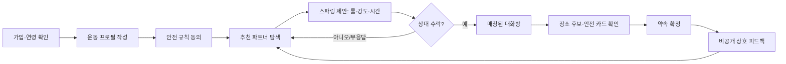
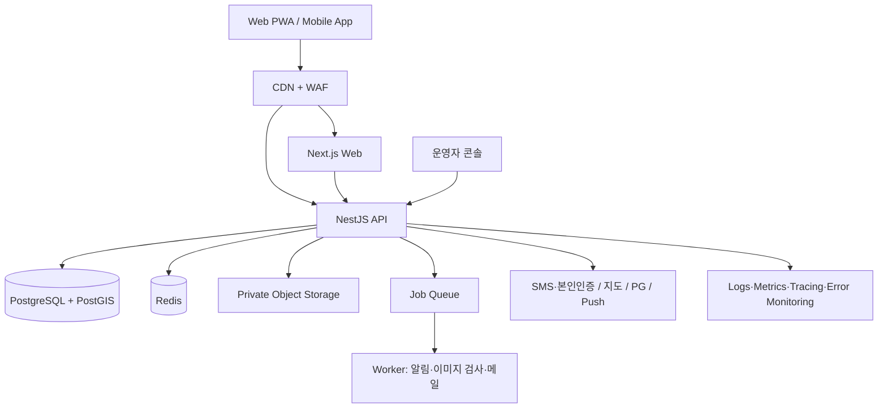
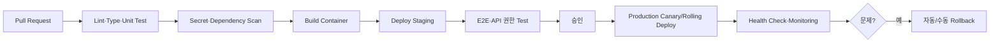

# SparringMatch — 스파링 기반 격투 스포츠 소셜·매칭 플랫폼 설계서

> 문서 버전: 1.1  
> 작성일: 2026-08-01 · 최근 갱신: 2026-08-27  
> 대상: SparringMatch 웹사이트·모바일 앱의 초기 기획, 설계, 개발, 운영 담당자

**함께 보는 문서**

- [docs/KOREA_COMBAT_SPORTS_MARKET_ANALYSIS.md](./docs/KOREA_COMBAT_SPORTS_MARKET_ANALYSIS.md) — 종목별 한국 격투기 시장 분석과 수익화 아이디어 (§13의 근거 자료)
- [docs/DATING_APP_MONETIZATION_ANALYSIS.md](./docs/DATING_APP_MONETIZATION_ANALYSIS.md) — 소개팅 앱 수익화 메커니즘 분석과 SparringMatch 적용·금지 목록 (§13의 근거 자료)
- [references/README.md](./references/README.md) — 영화 격투 영화 포스터 5종 무드 보드와 사용 원칙 (§5.3의 참고 자료)

## 0. 한 줄 정의

**SparringMatch은 비슷한 조건과 목표를 가진 격투 스포츠인이 안전하게 스파링 파트너를 찾고, 커뮤니티·체육관·이벤트·장비 정보를 이용하는 신뢰 기반 플랫폼이다.**

단순한 연애 매칭 서비스의 인터랙션은 참고할 수 있지만, 제품의 중심은 반드시 **상호 동의한 운동 파트너 연결**이어야 한다. 이 원칙이 지켜져야 격투기 커뮤니티에서 오래 신뢰받고, 실제 오프라인 만남의 위험도 낮출 수 있다.

---

## 1. 제품 방향과 성공 기준

### 1.1 해결하려는 문제

| 사용자 문제 | SparringMatch의 해결 방식 |
| --- | --- |
| 실력·체급·룰이 맞는 스파링 상대를 찾기 어렵다 | 종목, 체급, 실력, 스파링 강도, 룰, 가능 시간으로 탐색·추천한다. |
| 처음 보는 사람과의 스파링이 불안하다 | 본인 인증, 체육관 인증, 평판, 차단·신고, 상호 수락, 안전 가이드를 기본 제공한다. |
| 지역 격투기 정보가 흩어져 있다 | 체육관, 오픈매트, 대회, 세미나, 개인 이벤트를 한곳에서 찾는다. |
| 운동 질문과 중고·장비 정보가 분산돼 있다 | 종목별 커뮤니티와 검증된 장비 카탈로그/제휴 구매를 제공한다. |

### 1.2 핵심 가치 제안

1. **맞는 상대** — 신체 조건만이 아니라 종목, 룰, 목표, 경험, 가능한 시간까지 맞춘다.
2. **안전한 연결** — 연락처나 정확한 위치를 바로 노출하지 않고, 서로 수락한 뒤에만 다음 단계로 간다.
3. **격투기 전용 맥락** — 체육관·오픈매트·대회·장비라는 실제 운동 생활을 연결한다.
4. **신뢰를 축적하는 커뮤니티** — 매칭 후의 양방향 피드백과 운영 모더레이션으로 건전한 사용자를 보호한다.

### 1.3 MVP의 성공 지표

출시 첫 90일에는 설치 수보다 아래의 **안전한 실제 연결**을 본다.

| 지표 | 정의 | 초기 목표 예시 |
| --- | --- | --- |
| 프로필 완성률 | 필수 운동·지역 정보까지 완료한 가입자 / 가입자 | 60% 이상 |
| 매칭 수락률 | 받은 요청 중 수락된 요청 비율 | 20% 이상 |
| 첫 대화 전환율 | 매칭 후 24시간 내 1개 이상 메시지를 보낸 비율 | 55% 이상 |
| 스파링 약속 전환율 | 시간·장소 제안이 확정된 매칭 비율 | 15% 이상 |
| 안전 신고 처리 SLA | 긴급 신고의 1차 조치까지 걸린 시간 | 1시간 이내 |
| 재방문율 | 4주 후 재방문 사용자 비율 | 25% 이상 |

`스파링 약속 전환율`은 사용자의 동의를 받은 익명 이벤트 데이터로만 집계한다. 실제 스파링 여부나 부상 정보는 추적하지 않는다.

### 1.4 시장 근거 요약 (2026-08 조사)

상세 데이터·출처·한계는 [docs/KOREA_COMBAT_SPORTS_MARKET_ANALYSIS.md](./docs/KOREA_COMBAT_SPORTS_MARKET_ANALYSIS.md)를 본다. 이 설계서의 판단에 직접 영향을 주는 사실만 요약한다.

- **성인 취미 격투 수련은 성장 국면이다**: MZ 복싱 열풍(복싱장 일반인 회원이 절반 이상), 주짓수 수련인구 약 20만 명(2020 업계 추산)과 여성 수련 급증, ADCC Korea 등 그래플링 대회 성장. §2.1의 대상 종목(복싱·킥복싱/무에타이·주짓수·MMA·그래플링) 선정을 뒷받침한다.
- **태권도(도장 9,488곳, 8년 만의 최저)·유도·검도는 유소년 감소로 정체/쇠퇴** — 성인 스파링 매칭 타깃이 아니라 B2B(도장 관리·구인구직·용품) 잠재 고객으로 접근한다.
- **프로 생태계의 흥행이 검증됐다**: 블랙컴뱃 2024년 흑자(객단가 약 7만 원)·2026년 국내 최초 유료 관중 1만 명, ZFN 티켓 1분 매진, 굽네의 Road FC 타이틀 스폰서십. 격투기 유튜브(정찬성 109만·김동현 107만 구독)가 신규 유입 동력이며, 기존 다음 카페 커뮤니티는 고인물화 — 신규 세대용 커뮤니티 공백이 있다.
- **스파링 파트너 매칭 특화 국내 서비스는 부재**: 다짐(범용 운동 O2O), 므마·플로우콤프·KorBoxing 등 기능별 버티컬 파편만 존재 — SparringMatch의 화이트스페이스.
- **여성 시장이 성장 동력**: 생활체육 참여율은 여성(51.2%)이 남성(47.8%)을 앞서고, 주짓수·복싱 모두 여성 유입이 두드러진다. §10의 안전 설계가 곧 여성 시장 전략이다.
- **거시 환경**: 한국 스포츠산업 2024년 매출 84.7조 원(+4.5%, 역대 최대), 생활체육 참여율 52.2%(2025), 체력단련장업 +16.6%.

---

## 2. 가장 먼저 확정할 제품 원칙

### 2.1 권장 초기 범위

초기에는 **대한민국, 만 15세 이상, 4~6개 종목, 웹 PWA**로 범위를 좁힌다. 다만 만 15~18세는 일반 성인 기능이 아닌 **청소년 안전 모드**로 제공한다.

- 대상 종목: 복싱, 킥복싱/무에타이, 주짓수, MMA, 레슬링/그래플링, 태권도(겨루기) 중 운영 가능한 종목부터 선택
- 매칭 목적: 스파링, 드릴 파트너, 오픈매트 동행, 대회 준비, 운동 친구
- 제외: 무제한 개인 대련 모집, 청소년과 성인 간 1:1 매칭·DM, 의료·부상 진단, 연락처 판매, 직접 결제·정산을 동반하는 다중 판매자 마켓플레이스
- 출시 순서: **매칭 안전성 → 커뮤니티·체육관 → 이벤트 → 커머스**

장비 판매를 첫 MVP에 넣으면 재고·배송·반품·전자상거래·PG·판매자 정산까지 제품 난이도가 급격히 높아진다. 따라서 1차는 공식 브랜드/제휴몰의 상품 카탈로그와 제휴 링크, 2차는 단일 판매자 직접 판매, 3차에만 오픈마켓을 검토하는 순서가 안전하다.

### 2.2 풀어야 하는 사업 결정 10개

아래는 개발 시작 전에 대표가 결정해야 하는 항목이다. 별도 선택이 없다면 `권장 기본값`으로 시작한다.

| 결정 항목 | 권장 기본값 | 이유 |
| --- | --- | --- |
| 서비스 명칭 | `SparringMatch`은 작업명, 출시 전 상표 선행조사 | 유명 작품·브랜드와의 혼동·권리 문제를 줄인다. |
| 이용 연령 | 만 15세 이상. 만 15~18세는 청소년 안전 모드, 만 19세 이상은 일반 모드 | 청소년의 성인 접촉과 정확 위치 노출을 원천 차단하면서 운동 목적의 연결을 지원한다. |
| 매칭 성격 | 스파링/운동 파트너 중심, 연애 목적은 별도 태그 | 신뢰·안전 목적을 흔들지 않는다. |
| 지역 공개 단위 | 시·구 또는 격자 기반 대략 거리 | 집·회사 위치 노출을 막는다. |
| 정확한 체중 | 체급 또는 범위만 공개, 정확 수치는 비공개 선택 | 민감하고 악용될 수 있는 정보를 최소화한다. |
| 체육관 정보 | 운영팀 등록 + 체육관 운영자 ‘소유권 주장’ | 허위·중복 정보를 줄인다. |
| 본인 인증 | 가입 후 탐색 전 휴대폰 인증, 매칭 전 선택적 강화 인증 | 초기에 마찰과 안전의 균형을 맞춘다. |
| 결제 | 구독·부스트부터 PG 위탁결제 | 카드정보를 직접 다루지 않는다. |
| 운영 시간 | 신고는 24/7 접수, 긴급 큐 우선, 사람 검토는 운영정책 명시 | 안전 기대치를 정직하게 관리한다. |
| 초기 출시 지역 | 서울·경기 등 한 권역의 체육관 밀집 지역 | 매칭 유동성을 확보한다. |

### 2.3 서비스 포지셔닝 문구 예시

> 같은 종목, 비슷한 룰, 맞는 강도.  
> **SparringMatch에서 안전한 스파링 파트너를 찾아보세요.**

‘소개팅’이라는 표현은 마케팅에서 흥미를 만들 수 있지만, 앱 내 주요 CTA는 `스파링 제안`, `운동 파트너 찾기`, `오픈매트 동행`처럼 오해가 적고 안전한 언어를 권장한다. 특히 청소년 안전 모드에서는 연애·소개팅 성격의 카피와 기능을 사용하지 않고, 운동 파트너 연결로만 한정한다.

### 2.4 만 15~18세 청소년 안전 모드 — 필수 정책

만 15세 이상으로 연령을 낮추면, 서비스는 성인 서비스의 연령 숫자만 바꾼 형태가 되어서는 안 된다. 대한민국 「청소년 보호법」상 청소년의 범위와 실제 서비스의 데이터·대면 구조를 고려해 별도 안전 모드를 기본값으로 둔다. 최종 약관·동의·보호자 확인 방식은 출시 전 변호사와 개인정보보호 전문가가 실제 서비스 흐름에 맞게 확정한다.

| 영역 | 만 15~18세 청소년 안전 모드 | 만 19세 이상 일반 모드 |
| --- | --- | --- |
| 매칭 대상 | 청소년 사용자끼리만. 권장: 나이 차이 최대 1년 | 성인 사용자끼리만 |
| 목적 | 스파링, 기술 드릴, 오픈매트/공식 행사 동행만 | 스파링·운동 파트너 중심 |
| 1:1 대화 | 상호 매칭 뒤에만; 성인에게는 노출·DM 불가 | 상호 매칭 뒤에만 |
| 장소 | 인증된 체육관, 공개 오픈매트, 공식 이벤트 장소만 | 공개 체육관을 우선 권장 |
| 위치·연락처 | 정확 주소·실시간 위치·전화번호 노출 금지 | 정확 주소·전화번호 기본 비공개 |
| 프로필 미디어 | 기본 아바타 또는 검토된 사진만, 영상·외부 링크는 초기 비활성화 | 정책을 통과한 사진·영상 |
| 커뮤니티 | 청소년 전용 게시판/연령 분리 피드, 성인과의 개인 연락 기능 없음 | 일반 종목·지역 커뮤니티 |
| 결제·커머스 | 초기에는 구매·구독·유료 부스트 비활성화 | 성인 결제 정책에 따라 제공 |
| 운영 | 청소년 신고는 P0/P1 우선 큐, 보복 방지·즉시 차단 | 일반 신고 큐 + 긴급 우선 큐 |

추가 구현 규칙:

- 나이는 가입 시 서버에서 계산하고 `minor` / `adult` 권한 그룹을 부여한다. 클라이언트가 보내는 연령대 값은 신뢰하지 않는다.
- `minor`와 `adult` 사이에는 탐색, 추천, 좋아요, 스파링 요청, DM, 댓글 멘션, 그룹 초대, 연락처 공유가 모두 불가능해야 한다. 검색 결과에서 단순히 숨기는 것만으로는 부족하다.
- 청소년의 첫 오프라인 운동 약속은 인증 체육관·공개 이벤트 중에서만 선택하게 한다. 개인 집, 숙소, 비공개 장소, 좌표 입력은 허용하지 않는다.
- 가입 화면에는 운동 목적, 성인과 연결되지 않는다는 점, 외부 메신저·개인정보 요청을 거절하는 방법을 쉬운 언어로 안내한다. 만 14세 미만 사용자는 가입을 차단한다.
- 법정대리인 동의가 개인정보 보호법상 명시적으로 요구되는 연령과 별개로, 만 15~18세의 오프라인 매칭·유료 기능·위치 처리에는 보호자 고지 또는 동의 절차가 필요한지 법률 검토 후 확정한다. 이를 위해 불필요한 보호자 개인정보를 먼저 수집하지 않는다.
- 청소년 모드를 성인 모드로 바꾸는 것은 생일 도래 후 서버가 자동으로 처리하되, 권한 변경·재동의·프로필 공개 범위 확인을 요구한다.

---

## 3. 사용자와 핵심 이용 흐름

### 3.1 대표 사용자

| 페르소나 | 목표 | 불안 요소 | 꼭 필요한 기능 |
| --- | --- | --- | --- |
| 초중급 복서 민수 | 비슷한 체급의 가벼운 스파링 상대 찾기 | 실력 차, 무리한 강도, 사기 | 체급·강도 필터, 상호 수락, 후기 |
| 주짓수 수련자 지은 | 오픈매트에 함께 갈 동료 찾기 | 낯선 장소·개인정보 노출 | 체육관 인증, 공개 범위, 안전 체크인 |
| 아마추어 MMA 선수 준호 | 시합 준비 파트너와 세미나 정보 찾기 | 일정 조율, 룰 불일치 | 룰 카드, 가용 시간, 이벤트 캘린더 |
| 체육관 관장 | 신규 회원·오픈매트 홍보 | 허위 정보, 관리 부담 | 체육관 소유권 인증, 이벤트 등록, 통계 |
| 장비 브랜드 운영자 | 특정 종목 사용자에게 상품 알리기 | 광고 피로도 | 카테고리 타깃 제휴 슬롯, 성과 리포트 |

### 3.2 첫 주의 이상적인 경험



### 3.3 스파링 제안 카드에 반드시 포함할 것

매칭 요청을 ‘좋아요’ 하나로 끝내지 말고, 실제 운동에 필요한 최소 맥락을 함께 보낸다.

- 목적: 라이트 스파링 / 기술 드릴 / 오픈매트 / 시합 준비
- 종목·세부 룰: 예) 복싱 3R×2분, 헤드기어 사용 / 주짓수 노기
- 희망 강도: 가볍게 / 보통 / 강하게 — 강함을 권장하지 않는 설명 포함
- 희망 날짜·시간대와 장소 유형: 내 체육관 / 상대 체육관 / 공개 오픈매트
- 보호장비 보유 여부
- 초대 메시지 200자 이내
- ‘상대의 동의 없이 사진·영상 촬영 및 SNS 게시 금지’ 확인 문구

청소년 안전 모드의 제안은 `인증 체육관/공개 오픈매트/공식 이벤트` 중 장소를 반드시 하나 선택해야 하며, 개인 장소를 입력할 수 없다. 수락 후에도 성인 사용자와의 대화방·연락처 공유 기능은 생성되지 않는다.

정확한 주소·전화번호는 기본적으로 넣지 않는다. 체육관 장소를 고를 때도 상대가 수락하기 전에는 체육관의 대략적인 지역만 보여 준다.

---

## 4. 기능 설계: MVP와 이후 단계

### 4.1 MVP 기능 우선순위

| 우선순위 | 기능 | MVP 포함 | 구체적 범위 |
| --- | --- | --- | --- |
| P0 | 계정·동의·인증 | 예 | 이메일/소셜 로그인, 휴대폰 인증, 만 15세 이상 연령 확인, 청소년/성인 모드 분기, 약관·개인정보 동의, 계정 삭제 |
| P0 | 운동 프로필 | 예 | 지역, 종목, 체급/체중 범위, 키 범위, 운동 연차, 경력, 나이대, 사진, 목표, 공개 설정 |
| P0 | 파트너 탐색·매칭 | 예 | 조건 필터, 추천 카드, 제안, 상호 수락, 매칭 해제 |
| P0 | 안전한 채팅 | 예 | 매칭 후 1:1 대화, 차단, 신고, 메시지 삭제 정책, 이미지 업로드 제한 |
| P0 | 안전·운영 콘솔 | 예 | 신고 큐, 사용자 정지, 콘텐츠 숨김, 감사 로그, 운영자 권한 |
| P1 | 커뮤니티 | 예 | 종목·지역 게시판, 댓글, 좋아요, 신고, 공지, 검색 |
| P1 | 체육관 디렉터리 | 예 | 체육관 정보, 지도, 종목, 시설, 오픈매트, 후기, 소유권 주장 |
| P1 | 이벤트 | 예 | 대회·세미나·오픈매트 등록, 참가 관심 표시, 신고·승인 흐름 |
| P2 | 장비 카탈로그·제휴 | 이후 | 상품 탐색, 제휴 링크, 쿠폰/캠페인 측정 |
| P3 | 앱 내 결제·마켓 | 이후 | 구독, 부스트, 티켓, 단일 판매자 판매부터 단계적 도입 |
| P3 | 네이티브 앱 | 이후 | PWA 검증 뒤 React Native/Expo로 iOS·Android 확장 |

### 4.2 프로필 데이터 설계

#### 필수 정보

| 그룹 | 필드 | 공개 기본값 | 비고 |
| --- | --- | --- | --- |
| 계정 | 닉네임, 이메일, 인증 상태 | 닉네임·인증 뱃지만 공개 | 이메일은 절대 공개하지 않는다. |
| 기본 | 출생연도/나이대, 활동 지역 | 나이대·시/구 공개 | 생년월일 전체는 프로필에 노출하지 않는다. |
| 운동 | 주 종목, 보조 종목, 운동 연차 | 공개 | 종목별 선택지를 표준화한다. |
| 체격 | 체급 또는 체중 범위, 키 범위 | 공개 | 정확 체중/키는 선택적 비공개다. |
| 목표 | 스파링·드릴·오픈매트·시합 준비 | 공개 | 복수 선택 가능 |
| 매칭 | 희망 거리, 가능한 요일/시간, 강도 | 공개 | 정확 좌표가 아닌 조건이다. |
| 신뢰 | 본인 인증·체육관 인증 상태 | 뱃지만 공개 | 인증 원본은 노출하지 않는다. |

#### 선택 정보

- 프로필 사진 최대 6장, 짧은 운동 영상 1개(초기에는 보류 가능)
- 소속 체육관, 벨트/급수, 아마추어·프로 경력, 수상 경력
- 선호 룰, 선호 장비, 자기소개, 언어, 흡연 여부 등 일반 소개 필드
- 원하는 파트너 조건과 비공개 사유 없는 필터

#### 수집하지 않거나, 별도 법률 검토 후 최소 수집할 정보

- 주민등록번호, 신분증 원본, 정확한 집·직장 주소
- 부상 이력, 질병, 장애, 건강검진 정보 등 건강 관련 상세 정보
- 성적 지향·종교·정치 성향 등 서비스에 불필요한 민감한 정보
- 카드번호·CVC 등 결제 원정보

건강 상태는 스파링 안전에 중요해 보이지만, 플랫폼이 이를 수집·판단하면 민감정보와 책임 범위가 커진다. 초기에는 ‘현재 컨디션과 체육관 규칙을 스스로 확인한다’는 사전 안내 및 동의로 처리하고, 의료 조언처럼 보이는 기능은 만들지 않는다.

### 4.3 매칭·추천 로직

#### 하드 필터: 하나라도 맞지 않으면 추천하지 않음

- 계정 상태가 활성이고 휴대폰 인증을 완료했는가
- 같은 종목 또는 사용자가 허용한 호환 종목인가
- 연령대 정책을 만족하는가(청소년↔성인 1:1 매칭·DM 금지, 청소년은 같은 청소년 연령대 내에서만 연결), 지역·거리, 차단 관계, 이미 거절/신고된 관계가 아닌가
- 체급/체중 범위, 희망 강도, 가용 시간, 목적이 양쪽 허용 범위에 있는가
- 상대의 공개 범위와 추천 수신 설정을 모두 만족하는가

#### 랭킹 신호: 사용자에게 설명 가능한 가중치만 사용

```text
추천 점수 = 종목 적합도 × 35
          + 체급/키 범위 적합도 × 20
          + 스파링 목적·강도 적합도 × 20
          + 거리·시간대 적합도 × 15
          + 신뢰 신호(인증·건전 이용) × 10
```

- 점수는 상대에게 공개하지 않는다.
- 인종, 외모 점수, 민감정보, 친구 수, 유료 결제 여부는 랭킹 신호로 쓰지 않는다.
- `왜 이 사람을 추천하나요?`에는 “같은 복싱, 3~5년 수련, 5km 이내, 라이트 스파링 선호”처럼 사람이 이해할 문장만 표시한다.
- 신규 이용자가 영구적으로 묻히지 않도록 일정 비율의 탐색 슬롯을 둔다.
- 유료 부스트가 생기더라도 하드 필터·안전 규칙·차단 규칙을 절대 우회시키지 않는다.

### 4.4 커뮤니티

초기 게시판 구조는 과도하게 쪼개지지 않게 다음으로 시작한다.

- 종목별: 복싱 / 킥복싱·무에타이 / 주짓수 / MMA·그래플링 / 기타
- 지역별: 출시 권역 중심
- 주제별: 훈련 팁, 장비, 대회·세미나, 체육관 후기, 파트너 모집
- 고정 게시: 안전 수칙, 촬영·게시 동의, 커뮤니티 가이드라인, 신고 기준

필수 운영 기능은 게시물·댓글·이미지 신고, 금칙어/URL 탐지, 신규 계정의 도배 제한, 운영자 숨김/복원, 제재 이력, 이의 제기이다. 외부 메신저 아이디·전화번호·계좌번호를 무분별하게 올리는 게시물은 자동 경고 후 검토 대상으로 둔다.

### 4.5 체육관·이벤트

#### 체육관 카드

- 이름, 종목, 지역, 지도 핀(공개 사업장 주소), 운영 시간, 연락 방식, 시설/샤워 여부
- 초급 가능 여부, 오픈매트 시간, 1일 체험 여부, 체급별 클래스, 공식 링크
- `운영자 인증됨` 뱃지와 마지막 정보 갱신일
- 후기에는 실명·연락처·개인 사진을 자동 탐지/신고할 수 있게 한다.

#### 이벤트 등록 흐름

1. 개인 또는 체육관 운영자가 제목, 일시, 장소, 종목, 참가 조건, 비용, 이미지, 문의 링크를 작성한다.
2. 게시 전 정책 동의와 자동 검사(도박·불법 베팅·혐오·개인 연락처 과다 노출 등)를 수행한다.
3. 일반 사용자는 운영 검토 후 공개, 인증 체육관은 위험 신호가 없으면 빠른 검토 큐로 보낸다.
4. 참가 관심 표시와 캘린더 추가만 MVP에 넣는다. 외부 결제/티켓 발권은 후속 단계다.

### 4.6 장비 구매 기능의 단계적 설계

| 단계 | 사용자 경험 | 운영·법무 난이도 |
| --- | --- | --- |
| 1. 제휴 카탈로그 | 글러브·보호장비·도복을 보고 공식 판매처로 이동 | 낮음 |
| 2. 단일 판매자 스토어 | SparringMatch이 한 판매 주체의 상품을 PG로 판매 | 중간 |
| 3. 체육관 상품·클래스 | 인증 체육관의 체험권/굿즈 판매 | 높음 |
| 4. 다중 판매자 오픈마켓 | 여러 판매자 입점, 주문·정산·분쟁·반품 처리 | 매우 높음 |

처음부터 4단계로 가지 않는다. 다중 판매자 구조는 판매자 검증, 정산, 세금, 소비자 분쟁, 배송/반품, 표시·광고, 고객지원까지 별도 사업이 된다. 결제는 검증된 PG를 사용하고 카드정보를 SparringMatch 서버에 저장하지 않는다.

---

## 5. 정보 구조와 화면 설계

### 5.1 전역 메뉴

모바일 하단 탭은 5개를 넘기지 않는다.

| 메뉴 | 핵심 화면 | 주요 CTA |
| --- | --- | --- |
| 홈 | 오늘의 추천, 가까운 오픈매트, 이벤트, 안전 알림 | `파트너 둘러보기` |
| 찾기 | 카드/목록, 필터, 저장 조건 | `스파링 제안 보내기` |
| 커뮤니티 | 피드, 종목·지역 필터, 글쓰기 | `질문 올리기` |
| 지도 | 체육관, 오픈매트, 이벤트 핀 | `체육관 보기` |
| 내 정보 | 프로필, 매칭, 채팅, 저장, 설정 | `프로필 완성하기` |

채팅과 알림은 하단 탭이 아니라 헤더의 배지 아이콘으로 접근하게 하면 `내 정보`가 과도하게 비대해지는 것을 막을 수 있다. 웹에서는 좌측/상단 네비게이션으로 같은 구조를 제공한다.

### 5.2 홈 화면 와이어프레임

```text
┌───────────────────────────────────────────────────┐
│ [FC 홈 아이콘] SparringMatch         알림(2)  메시지(1) │
├───────────────────────────────────────────────────┤
│  같은 룰, 맞는 강도.                                │
│  오늘의 스파링 파트너를 찾아보세요.                  │
│  [조건으로 찾기]  [프로필 완성 80%]                 │
├───────────────────────────────────────────────────┤
│  추천 파트너                                         │
│  [사진] 복싱 · 라이트 · 3~5년 · 약 4km              │
│  “평일 저녁 3R 라이트 스파링 가능”  [제안 보내기]   │
├───────────────────────────────────────────────────┤
│  이번 주 내 주변                                     │
│  [오픈매트 카드] [세미나 카드] [대회 카드]           │
├───────────────────────────────────────────────────┤
│  커뮤니티 인기글          체육관 추천                │
└───────────────────────────────────────────────────┘
```

### 5.3 빨강·검정 비주얼 시스템

참고 이미지의 강한 음각 타이포그래피, 광택, 역동적인 기울기는 분위기만 차용한다. 이미지에 보이는 `FIGHT CLUB` 로고를 그대로 복제하거나 유사한 입체 워드마크를 상표로 사용하지 않는다. 출시 전 상표·저작권 전문가의 선행 검토가 필요하다.

무드 레퍼런스로 영화 격투 영화(1999) 공식 포스터 5종을 `references/posters/`에 정리했다. 각 포스터에서 차용할 요소(네온 포인트 광원, 레드 모노톤 타이포, 보색 상태 색, 일러스트 빈 상태 아트)와 금지 사항은 [references/README.md](./references/README.md)를 따른다. **이미지 자체는 내부 참고 전용이며 서비스·마케팅에 게시하지 않는다.**

#### 디자인 토큰 (2026-08-27 베타 v2 "네온 & 그레인" 구현 기준)

| 용도 | 토큰 | 색상 | 사용 원칙 |
| --- | --- | --- | --- |
| 기본 배경 | `--bg` | `#08080B` | 먹색. 필름 그레인(≤5%)·비네트 오버레이와 함께 사용(포스터 03·04의 질감) |
| 표면 | `--surface` | `#121118` | 카드·패널 기본 |
| 강조 표면 | `--surface-2` / `--surface-3` | `#1A1922` / `#242330` | 호버·선택 상태 |
| 네온 로제 | `--red` / `--red-strong` | `#E63248` / `#FF5E74` | CTA·활성 상태·네온 글로우에 한정(포스터 02의 네온관) |
| 핏빛 | `--red-deep` | `#A11626` | 그라데이션 끝, 위험 맥락 |
| 텍스트 기본 | `--text` | `#F4F2EE` | 따뜻한 종이색 본문 |
| 보조 텍스트 | `--muted` / `--dim` | `#A5A1AC` / `#6E6A78` | 설명·메타 정보 |
| 안전 상태 | `--green` | `#A8E04A` | 독초록(포스터 04). 인증·성공·안전 전용 — 레드만으로 상태를 표현하지 않는다 |
| 주의 상태 | `--yellow` | `#F5C24B` | 형광등 옐로. 정책·주의 안내 |

- 레드는 화면 면적의 약 10~15% 이내로 쓰고, 배경 전체를 붉게 칠하지 않는다. 네온 글로우(`text-shadow`/`box-shadow`)는 헤드라인 강조어, 활성 상태, 브랜드 마크에만 허용하고 본문·긴 문장에는 금지한다.
- 시그니처 요소: 한글 네온사인 헤드라인 + `SEOUL SPARRING CLUB` 트래킹 레터링(포스터 02의 사인 구조를 우리 고유 워드마크로 번역), 로그인 화면의 바닥 반사, 히어로의 아웃라인 워터마크 활자(포스터 01). 영화 로고의 글자 형태는 복제하지 않는다.
- 네온 점등 플리커는 페이지 로드 시 1회만, `prefers-reduced-motion`에서는 완전히 제거한다.
- CTA의 흰색 텍스트와 배경은 WCAG AA 수준의 대비를 실제 색상 조합별로 검사한다.
- 위험·차단·오류에 브랜드 레드를 쓰더라도 아이콘·문구를 같이 사용해 색각 이상 사용자도 구분할 수 있게 한다.
- 모서리: 카드 `18px`, 버튼 `12px`, 칩 `999px`. 지나치게 날카로운 ‘폭력’ 인상보다 절제된 스포츠 감성을 사용한다.
- 폰트: 본문은 Noto Sans KR(웹폰트, Pretendard·시스템 대체), 디스플레이(헤드라인·큰 숫자·워터마크)는 Black Han Sans — 한국 영화 포스터 활자의 무게감을 내는 한글 전용 디스플레이 서체. 장문에는 쓰지 않는다.

### 5.4 홈 아이콘 제안

**권장안: 독자적인 `FC` 모노그램 방패 아이콘**

- 둥근 사각형 또는 작은 방패 안에 기울어진 `F`와 `C`의 음각/양각 레이어를 결합한다.
- 바탕은 `#0B0B0D`, 전면은 `#E63946`에서 `#8D1621`로 이어지는 짧은 그라데이션을 사용한다.
- 광택은 아주 약하게, 그림자는 1단계로 제한한다. 작은 24px 아이콘에서도 글자가 뭉개지지 않아야 한다.
- 로고형 홈 버튼에는 `FC`만, 랜딩 페이지에는 별도의 고유 워드마크 `SparringMatch`을 사용한다.
- SVG는 직접 제작하여 소유하고, 원본 참조 이미지의 글자 형태·레이아웃·질감을 재현하지 않는다.

아이콘 상태:

| 상태 | 표현 |
| --- | --- |
| 기본 | 딥 차콜 바탕 + 레드 모노그램 |
| 현재 홈 | 레드 표면 + 흰색 모노그램 + 2px 하단 인디케이터 |
| 포커스 | 3px 흰색/레드 이중 포커스 링 |
| 비활성 | `--text-secondary` 계열의 단색, 낮은 대비 금지 |

### 5.5 접근성·반응형 기준

- 최소 터치 영역: 44×44px
- 키보드만으로 모든 웹 화면 이용, 명확한 포커스 표시, 모달 포커스 트랩
- 이미지에는 대체 텍스트, 동영상에는 자막/무음 자동재생 금지
- 200% 확대에서도 가로 스크롤 없이 핵심 기능 이용
- 애니메이션은 `prefers-reduced-motion`을 준수
- 모바일 우선 360px, 태블릿 768px, 데스크톱 1280px 기준으로 설계
- 사용자 사진은 자동으로 성별·인종·실력 등을 추론하는 AI 기능을 만들지 않는다.

---

## 6. 권장 기술 아키텍처

### 6.1 기술 선택

초기 팀의 학습·운영 비용을 낮추기 위해 **TypeScript 단일 언어 기반 모놀리식 백엔드 + 모듈형 구조**를 권장한다. 처음부터 마이크로서비스로 쪼개지 않는다.

| 계층 | 권장 기술 | 선택 이유 |
| --- | --- | --- |
| 웹 | Next.js + TypeScript + Tailwind CSS + 접근성 있는 UI primitive | SEO, PWA, 서버 렌더링, 빠른 화면 개발 |
| 모바일 | 1차 PWA, 검증 뒤 Expo/React Native | 같은 TypeScript·디자인 토큰 재사용 |
| API | NestJS + REST + OpenAPI | 모듈, 검증, 권한 가드, 문서화에 적합 |
| DB | PostgreSQL + PostGIS | 관계형 데이터·거리 검색·트랜잭션 |
| ORM | Prisma 또는 Drizzle/Kysely 중 팀 숙련도 기준 선택 | 마이그레이션·타입 안전성 |
| 캐시/큐 | Redis + BullMQ | 속도 제한, 세션/캐시, 알림·이미지 후처리 |
| 파일 | S3 호환 오브젝트 스토리지 + CDN | 사진·이벤트 이미지의 안전한 저장·전송 |
| 검색 | 초기 PostgreSQL FTS, 성장 후 OpenSearch/Meilisearch 검토 | 초기에 운영 서비스 수를 줄임 |
| 실시간 | WebSocket Gateway 또는 관리형 실시간 서비스 | 매칭·채팅·알림 |
| 푸시 | FCM + APNs | 모바일/웹 푸시 |
| 오류·관측 | Sentry + OpenTelemetry + CloudWatch | 프런트·백엔드 오류와 성능 추적 |
| 분석 | 익명화된 제품 이벤트 도구 | 퍼널·리텐션 측정, 원문 메시지 수집 금지 |

### 6.2 논리 아키텍처



외부 서비스의 웹훅은 별도 엔드포인트에서 서명 검증, 허용 IP/도메인 검토, 멱등성 키, 재시도 처리를 거친 뒤 큐로 넘긴다. 결제 성공 알림 하나만 믿고 주문 상태를 바꾸지 말고, PG의 검증 API 또는 서명된 웹훅으로 확정한다.

### 6.3 저장소 구조 예시

```text
sparringmatch/
├─ apps/
│  ├─ web/                 # Next.js PWA
│  ├─ api/                 # NestJS API
│  ├─ admin/               # 운영자 콘솔 (초기에는 web 내부 보호 라우트도 가능)
│  └─ mobile/              # Expo 앱, PWA 검증 뒤 추가
├─ packages/
│  ├─ ui/                  # 공용 디자인 시스템
│  ├─ config/              # eslint, tsconfig, tailwind token
│  ├─ types/               # DTO/도메인 타입
│  └─ api-client/          # OpenAPI 생성 클라이언트
├─ infra/
│  ├─ terraform/           # 클라우드 IaC
│  └─ docker/
├─ docs/
│  ├─ adr/                 # Architecture Decision Record
│  ├─ api/
│  └─ policies/
└─ .github/workflows/      # CI/CD와 보안 검사
```

`pnpm workspace + Turborepo` 같은 모노레포를 사용하면 UI 토큰, 타입, 린트 규칙을 공유하기 좋다. 단, DB 접근과 비밀값은 서버 앱에만 둔다.

---

## 7. 데이터 모델과 API 계약

### 7.1 핵심 엔터티

| 엔터티 | 핵심 컬럼 | 설계 메모 |
| --- | --- | --- |
| `users` | id, email, phone_verification, status, role, created_at | 이메일·전화는 암호화/분리 접근을 검토한다. |
| `consents` | user_id, policy_version, consent_type, granted_at | 약관 버전별 동의 이력을 보관한다. |
| `profiles` | user_id, nickname, birth_year, age_band, user_mode, region_code, bio, visibility | 생년월일은 권한 판정용으로만 최소 보관하고, 화면에는 나이대만 노출한다. `user_mode`는 서버가 계산한 `minor`/`adult`다. |
| `sport_profiles` | profile_id, sport, experience_years, level, gym_id | 사용자별 복수 종목 지원 |
| `physical_profiles` | profile_id, weight_class, height_range, exact_visibility | 범위·체급을 우선 저장 |
| `availability_slots` | profile_id, weekday, start_time, end_time | 시간대 기준을 명시한다. |
| `profile_media` | profile_id, object_key, moderation_status, sort_order | 공개 전 검사 상태 필수 |
| `match_preferences` | profile_id, distance, sports, goals, intensity, filters | 사용자 선택을 단일 JSON에 방치하지 말고 검증한다. |
| `sparring_requests` | sender_id, receiver_id, rule_set, intensity, venue_type, status, expires_at | 요청 당시 조건·연령 모드·장소 유형을 스냅샷으로 남긴다. 청소년 요청은 승인된 장소 유형만 허용한다. |
| `matches` | user_a_id, user_b_id, source_request_id, status | 두 사용자 쌍에 유니크 제약 |
| `conversations`, `messages` | match_id, sender_id, body, media_key, sent_at | 차단·삭제·보존 정책을 분리한다. |
| `blocks`, `reports` | reporter_id, target_type/id, reason, evidence_key, status | 신고 사유와 운영 조치 감사 로그 |
| `gyms`, `gym_claims` | name, address, geo, owner_status | 체육관 주소는 공개 사업장 정보에 한정 |
| `events`, `event_rsvps` | organizer, time, venue, review_status | 검토 상태·수정 이력 필요 |
| `posts`, `comments`, `reactions` | board, author, content, state | 소프트 삭제·모더레이션 상태 |
| `products`, `affiliate_clicks`, `orders` | stage에 따라 분리 | 주문·정산은 MVP 데이터 모델에서 제외 가능 |
| `audit_logs` | actor, action, target, metadata, ip_hash | 운영자 행위는 변경 불가능한 감사 로그 |

### 7.2 관계와 무결성 규칙

- 이메일, 휴대폰, 닉네임(대소문자 정규화)은 적절한 유니크 제약을 둔다.
- `matches`는 `(least(user_a,user_b), greatest(user_a,user_b))`가 유일해야 한다.
- 차단 관계가 생기면 기존 매칭·대화의 새 메시지를 즉시 막고 추천 인덱스에서도 제외한다.
- 청소년과 성인 사이의 관계는 DB 조회·추천 인덱스·캐시·실시간 구독 어느 경로에서도 생성되지 않도록 `user_mode` 조건을 서버 쿼리에 강제한다.
- 운영자 제재 상태의 사용자는 토큰을 즉시 무효화할 수 있어야 한다.
- 모든 외부 파일은 DB에 공용 URL이 아니라 `object_key`, 콘텐츠 타입, 검사 상태만 저장한다.
- 삭제 요청은 사용자 화면에서는 즉시 비식별/비노출 처리하고, 법정·분쟁·보안 보관 기간은 법률 자문에 따라 별도 삭제 작업으로 관리한다.

### 7.3 REST API 예시

| 메서드·경로 | 용도 | 반드시 확인할 권한 |
| --- | --- | --- |
| `POST /v1/auth/signup` | 가입 시작 | 속도 제한, 봇 방지 |
| `POST /v1/auth/verify-phone` | 휴대폰 OTP 확인 | 시도 횟수·쿨다운 |
| `GET/PATCH /v1/me/profile` | 내 프로필 조회·수정 | 본인만, 필드별 허용 목록 |
| `GET /v1/discovery` | 추천 목록 | 차단·공개범위·연령 모드·필터를 서버에서 강제 |
| `POST /v1/sparring-requests` | 스파링 제안 | 송신·수신 연령 모드, 장소 유형, 중복·쿨다운 검사 |
| `POST /v1/sparring-requests/:id/respond` | 수락/거절 | 수신자만, 상태 전이 검증 |
| `GET/POST /v1/matches/:id/messages` | 매칭 채팅 | 매칭 양 당사자·비차단 상태 |
| `POST /v1/reports` | 신고 | 증거 파일 접근 제한, 긴급 분류 |
| `POST /v1/blocks/:userId` | 차단 | 본인만; 즉시 서버 전파 |
| `GET /v1/gyms` | 체육관 탐색 | 지도 쿼리 입력값 제한 |
| `POST /v1/events` | 이벤트 작성 | 신뢰도·검토 정책 적용 |
| `POST /v1/admin/*` | 운영 조치 | 별도 관리자 RBAC와 재인증 |

API 응답은 ‘필요한 데이터만’ 반환하는 전용 DTO를 쓴다. 예를 들어 다른 사용자의 상세 프로필 API가 `email`, `phone`, 내부 제재 메모, 정확한 좌표, 인증 원본, 정확한 생년월일을 우연히 직렬화해서는 안 된다.

### 7.4 상태 머신 예시

```text
스파링 요청: draft → sent → accepted → matched
                         ↘ declined / expired / cancelled / blocked

신고: received → triaged → investigating → actioned / dismissed → appealed(optional)

미디어: uploaded → scanning → approved / rejected / quarantined
```

상태 변경은 아무 PATCH나 허용하지 않는다. 가능한 전이만 서버의 도메인 서비스에서 수행하고, `who/when/why`를 감사 로그에 남긴다.

---

## 8. 프런트엔드 구현 계획

### 8.1 화면 단위와 완료 기준

| 화면 | 사용자 행동 | 완료 기준 |
| --- | --- | --- |
| 온보딩 | 가입, 동의, 스포츠·지역 입력 | 중단 후 재개 가능, 동의 버전 기록, 오류 문구 명확 |
| 프로필 편집 | 공개 범위와 운동 조건 설정 | 각 필드의 공개 대상이 미리 보임 |
| 탐색 | 필터·정렬·카드 탐색 | 서버 필터와 UI 표시가 정확히 일치 |
| 상대 프로필 | 조건 확인 후 제안 | 정확 주소·전화·민감정보 없음 |
| 제안 작성 | 룰·강도·시간을 선택 | 필수 안전 필드가 비어 있으면 발송 불가 |
| 매칭 채팅 | 약속 조율, 차단·신고 | 상대 차단 시 즉시 입력 비활성화 |
| 커뮤니티 | 글·댓글 작성과 신고 | 게시 전 정책 안내와 이미지 상태 표시 |
| 체육관/이벤트 | 탐색, 저장, 관심 표시 | 지도 로딩 실패·빈 상태에 대체 UX 제공 |
| 설정 | 알림, 개인정보, 다운로드, 탈퇴 | 데이터·탈퇴 흐름이 숨겨져 있지 않음 |
| 운영 콘솔 | 신고 검토·제재 | 모든 조치에 권한·사유·감사 로그 |

### 8.2 컴포넌트 시스템

공통 컴포넌트를 먼저 만들면 이후 기능 속도가 빨라진다.

- `AppShell`, `TopBar`, `BottomNavigation`, `PageHeader`
- `ProfileCard`, `TrustBadge`, `SportChip`, `RuleSetCard`, `IntensityBadge`
- `SafetyNotice`, `ReportSheet`, `BlockConfirmDialog`, `EmptyState`
- `FilterSheet`, `RangeSelector`, `AvailabilityPicker`, `LocationPrivacyControl`
- `GymCard`, `EventCard`, `PostCard`, `ModerationStatus`
- `PrimaryButton`, `DestructiveButton`, `IconButton`, `Toast`, `Skeleton`

모든 상태(loading / error / empty / disabled / focus / reduced motion)를 디자인 명세에 포함한다. ‘정상 화면’만 디자인하면 실제 앱 품질이 낮아진다.

### 8.3 프런트엔드 품질 규칙

- API 타입은 OpenAPI 계약으로 생성하거나 공용 DTO 패키지로 공유한다.
- 폼은 클라이언트 검증을 하되 서버 검증을 대체하지 않는다.
- 토큰·비밀값은 브라우저 저장소에 직접 두지 않는다. 인증 설계에 맞는 `HttpOnly`, `Secure`, `SameSite` 쿠키나 안전한 모바일 저장소를 사용한다.
- 이미지 업로드는 서버가 발급한 짧은 만료의 서명 URL로만 하고, 업로드 완료 후 서버 검사 상태를 기다린다.
- 무한 스크롤은 커서 기반 페이지네이션을 사용하며, URL에 필터 상태를 반영해 공유·뒤로가기를 자연스럽게 한다.
- 모바일 네트워크 단절, 느린 연결, 푸시 권한 거절, 위치 권한 거절에도 핵심 탐색을 막지 않는다.

---

## 9. 백엔드 구현 계획

### 9.1 NestJS 도메인 모듈

```text
auth          users          profiles        discovery
matching      messaging      moderation      community
gyms          events         media           notifications
payments      admin          analytics        audit
```

- Controller는 HTTP 입력·출력만 담당하고, 권한·검증·상태 전이는 Service/Domain Layer에 둔다.
- Repository는 DB 접근을 감추되, 복잡한 PostGIS 쿼리는 성능 테스트 가능한 명시적 쿼리로 관리한다.
- 이벤트 발행은 트랜잭션 아웃박스(outbox) 패턴을 고려한다. 예를 들어 매칭 수락 DB 저장은 성공했는데 푸시 전송만 실패해도 재시도할 수 있다.
- MVP에서는 단일 배포 서비스 안의 모듈로 시작하고, 대화·검색·추천 부하가 검증될 때만 분리한다.

### 9.2 거리 검색과 위치 보호

1. 사용자에게 정확 위치 권한을 요청하지 않고 먼저 활동 시/구 또는 직접 선택한 지역만 받는다.
2. 거리 필터가 필요하면 동의한 사용자의 좌표를 서버에서 H3/Geohash 격자 또는 반올림 좌표로 저장하고, 앱에는 `약 3km`처럼 버킷화된 거리만 보여 준다.
3. 데이터베이스에서 PostGIS `ST_DWithin`으로 후보를 찾되, API에는 정확한 좌표를 반환하지 않는다.
4. 매칭 이후에도 주소 공유는 사용자가 메시지에서 선택적으로 하며, 공개 체육관 장소를 우선 제안한다.

위치 데이터 처리 방식과 보관 기간은 실제 법률·서비스 구조에 따라 위치정보 관련 법령 검토가 필요하다. ‘대략적 지역’이라고 해도 특정 개인을 식별·추적할 수 있는 설계가 되지 않도록 개인정보 전문가에게 사전 검토받는다.

### 9.3 사진·영상 처리 파이프라인

```text
클라이언트 요청
  → API가 파일 크기·MIME·용도 확인
  → 짧은 만료 서명 업로드 URL 발급
  → 비공개 버킷 업로드
  → 악성 파일 검사·이미지 리사이즈·콘텐츠 정책 검사 작업 큐
  → approved 상태만 CDN 서명 URL로 제공
```

- 허용 목록 MIME 타입, 실제 파일 헤더 검사, 파일명 무시, 최대 크기·해상도 제한
- 원본 EXIF 위치정보 제거 후 파생본 사용
- 모든 미디어는 기본 private, 사용자 권한을 확인한 뒤 짧은 만료 URL 발급
- 프로필·게시물에 공개할 수 없는 노출·폭력·불법 콘텐츠의 검토 정책을 사람 검토와 함께 마련
- AI 자동 판정은 보조 신호일 뿐 최종 제재의 유일한 근거로 쓰지 않는다.

---

## 10. 안전, 보안, 개인정보 보호

### 10.1 서비스 안전 정책은 기능의 일부다

격투 스포츠 매칭은 부상 위험뿐 아니라 괴롭힘, 스토킹, 사칭, 동의 없는 촬영, 체급·실력 차이를 악용한 위험이 있다. 이용약관만으로 처리하지 말고 제품 흐름에 안전장치를 넣는다.

| 위험 | 제품 통제 |
| --- | --- |
| 사칭·가짜 계정 | 휴대폰 인증, 의심 행위 탐지, 선택적 강화 인증, 신규 계정 한도 |
| 스토킹·개인정보 노출 | 대략 지역, 연락처 비공개, 매칭 후 채팅, 차단 시 즉시 분리 |
| 원치 않는 고강도 스파링 | 강도·룰·보호장비 사전 합의 카드, 언제든 취소 가능 |
| 촬영·게시 피해 | 사전 동의 안내, 신고 카테고리, 증거 보존·삭제 요청 절차 |
| 혐오·성희롱·괴롭힘 | 명확한 금지 정책, 필터·신고·제재, 반복 위반 계정 차단 |
| 사기·외부 결제 유도 | 계좌·외부 링크 경고, 의심 신고, 결제 안내 고정 |
| 체육관/이벤트 사칭 | 운영자 소유권 주장, 서류/도메인·전화 확인 등 별도 검증 절차 |
| 청소년 대상 접근·유인 | 청소년/성인 완전 분리, 청소년 전용 커뮤니티, 외부 연락처·개인 장소·유료 기능 제한 |

### 10.2 안전 UX 체크리스트

- 최초 매칭 전: 커뮤니티 가이드라인과 ‘스파링은 상호 동의·안전 규칙 아래 진행’ 안내
- 제안 작성 전: 룰·강도·장소 유형·시간을 명시하게 하고, 임의의 위험 행위를 부추기는 문구 금지
- 매칭 후: 공개 체육관 우선, 친구에게 약속 공유(개인정보 최소화), 비상 상황은 지역 긴급전화 사용 안내
- 대화 중: 차단·신고를 메뉴 깊숙이 숨기지 않고, 상대에게 알리지 않는다는 문구 제공
- 스파링 후: 익명 양방향 피드백(예: 약속 준수, 룰 존중, 다시 운동하고 싶은가)과 심각한 위험 신고 경로
- 운영자: 긴급 신고, 일반 신고, 콘텐츠 신고를 분리한 우선순위 큐와 대응 매뉴얼

청소년 안전 모드에서는 사용자에게 “상대가 성인이 아님”을 강조하는 라벨을 붙이지 않는다. 대신 시스템이 연령대 정책을 자동 적용하고, 청소년끼리의 연결이라는 안전 안내만 제공한다. 상대의 정확한 생년월일·학교·집·보호자 정보는 어느 화면에도 표시하지 않는다.

SparringMatch은 오프라인 스파링을 보증하거나 의료·법률 판단을 하는 기관이 아니다. 하지만 이 사실이 안전 투자 의무를 줄여 주지는 않는다. 위험 감지·신고 대응·차단을 실제로 작동하게 만드는 것이 중요하다.

### 10.3 애플리케이션 보안 기준

OWASP API Security Top 10은 객체 수준 인가, 인증, 리소스 소비, 민감 비즈니스 흐름 등 API 중심 위험을 다룬다. SparringMatch에서는 특히 **다른 사용자의 프로필·대화·신고·운영 기능에 대한 인가 실패**가 치명적이다. [OWASP API Security Top 10](https://owasp.org/www-project-api-security/)을 최소 기준으로 삼고, 출시 전에 아래 항목을 검증한다.

| 영역 | 필수 통제 |
| --- | --- |
| 인증 | 비밀번호는 Argon2id/bcrypt 같은 검증된 단방향 해시, 계정 복구·로그인에 강한 rate limit, 탈취 의심 시 세션 폐기, 민감 변경 재인증 |
| 세션 | 짧은 수명의 access token, 회전 가능한 refresh token, 탈취 감지·강제 로그아웃, 웹 쿠키 보안 속성 |
| 인가 | 모든 리소스에서 `현재 사용자`와 소유자/참여자/RBAC를 서버에서 검사, 기본 거부(deny by default) |
| 입력 | DTO 스키마 검증, 허용 필드 목록, 길이·형식 제한, SQL은 파라미터 바인딩 |
| XSS/CSRF | 출력 인코딩, 안전한 Markdown/HTML sanitizer, CSP, 쿠키 인증 시 CSRF 방어 |
| 속도 제한 | 로그인·OTP·가입·좋아요·메시지·검색·업로드별 별도 한도, IP·계정·기기 신호 조합 |
| 파일 | MIME/매직바이트 확인, 바이러스 검사, EXIF 제거, private storage, 다운로드 헤더 |
| 비밀값 | 코드·클라이언트 번들에 넣지 않고 Secret Manager 사용, 키 회전, 환경별 분리 |
| 오류·로그 | 사용자에게 stack trace 금지, 로그의 토큰·전화·메시지 본문 마스킹, 감사 로그 위변조 방지 |
| 공급망 | lockfile, 의존성 취약점 검사, SBOM, 서명된 CI 산출물, 정기 패치 |

OWASP는 API에서 인가 문제가 특히 중요하며, 관리자 기능은 기본 거부 후 명시적 역할 권한을 부여하라고 권고한다. [기능 수준 인가 가이드](https://owasp.org/API-Security/editions/2023/en/0xa5-broken-function-level-authorization/)를 따라 운영자 API와 일반 사용자 API를 논리적으로 분리한다.

### 10.4 개인정보 보호 설계

#### 데이터 최소화 원칙

- 프로필 노출에 꼭 필요한 정보와 계정 운영에 필요한 정보를 별도 모델·권한으로 나눈다.
- 정확 주소, 이메일, 휴대폰, 결제 식별자, 인증 원본은 일반 조회 API에 절대 섞지 않는다.
- 분석 데이터는 사용자 ID를 직접 쓰지 말고, 가능하면 가명 식별자·집계 지표를 사용한다.
- 개발·스테이징 환경에 실사용자 DB를 복제하지 않는다. 불가피한 경우 비식별·마스킹 절차와 접근 승인을 둔다.
- 보관 기간, 파기 방식, 제3자 제공·처리위탁, 국외 이전 가능성, 이용자 권리 요청 창구를 데이터 인벤토리로 관리한다.

#### 이용자 권리 기능

- 개인정보 처리방침과 약관을 가입 전·설정 화면에서 쉽게 열 수 있게 한다.
- 프로필 공개 범위를 세부 필드별로 설명한다.
- 내 정보 열람/수정, 알림 동의 철회, 계정 삭제, 데이터 다운로드 요청 채널을 제공한다.
- 탈퇴 전 매칭·게시물·구매·분쟁 기록의 처리 기준을 명확히 안내한다.
- 신분증 등 고위험 인증 수단을 도입한다면 수집 목적·보관·파기와 위탁사를 별도 동의·심사한다.

한국 출시라면 현행 [개인정보 보호법](https://www.law.go.kr/unSc.do?menuId=10&query=%EA%B0%9C%EC%9D%B8%EC%A0%95%EB%B3%B4+%EB%B3%B4%ED%98%B8%EB%B2%95), 위치·결제·전자상거래 관련 법령, 플랫폼의 실제 데이터 흐름을 변호사/개인정보보호 전문가에게 출시 전 검토받아야 한다. 이 문서는 법률 자문이 아니다. 개인정보 처리방침은 템플릿 복사가 아니라 실제 수집·보관·위탁·제공·파기 현황을 반영해 작성한다. 개인정보보호위원회는 처리방침 작성지침을 지속 개정하고 있으므로 최신 안내를 확인한다. [개인정보보호위원회](https://www.pipc.go.kr/)  

### 10.5 역할 기반 접근 통제(RBAC)

| 역할 | 권한 | 제한 |
| --- | --- | --- |
| 일반 사용자 | 본인 프로필·매칭·게시물 관리, 신고 | 다른 사용자의 비공개 정보 접근 불가 |
| 인증 체육관 운영자 | 본인 체육관·이벤트 관리 | 사용자 DM 일괄 발송, 다른 체육관 변경 불가 |
| 모더레이터 | 신고 검토, 콘텐츠 숨김, 제한된 제재 | 전화·이메일·결제 세부 정보 접근 불가 |
| 개인정보 담당자 | 권리 요청 처리, 최소 정보 조회 | 일상 모더레이션 권한 분리 |
| 슈퍼 관리자 | 역할·정책·긴급 조치 | MFA, 재인증, IP/기기 정책, 감사 필수 |

운영자 권한은 최소 권한·기간 제한 원칙을 따르고, 일반 직원이 사용자 메시지 원문이나 인증 서류를 아무 때나 열람할 수 없게 한다.

### 10.6 보안 테스트 게이트

| 시점 | 필수 검사 |
| --- | --- |
| PR | lint, 타입 검사, unit test, secret scan, 의존성 취약점 검사 |
| 스테이징 배포 | E2E, API 계약 테스트, 인증·권한 테스트, DAST 기본 검사 |
| 출시 전 | 제3자 침투 테스트 또는 전문 리뷰, 복구 리허설, 개인정보 데이터 흐름 점검 |
| 매 분기 | 권한 회귀 테스트, 패치·키 회전·백업 복구 테스트, 위협 모델 업데이트 |
| 사고 발생 후 | 타임라인·영향 범위·재발 방지 조치가 포함된 사후 분석 |

특히 두 개의 테스트 계정 A/B를 사용해 `A가 B의 프로필, 요청, 대화, 신고, 업로드 URL을 ID만 바꿔 접근할 수 없는지` 자동 통합 테스트로 만든다. 이것이 객체 수준 인가 취약점(IDOR/BOLA)을 조기에 막는 가장 실용적인 방법이다.

---

## 11. 운영, 모더레이션, 고객지원

### 11.1 신고 사유와 초기 대응

| 신고 분류 | 예시 | 우선순위 | 초기 조치 |
| --- | --- | --- | --- |
| 즉시 위험 | 협박, 스토킹, 폭력 예고, 미성년 의심 | P0 | 노출/연락 차단, 계정 제한, 증거 보존, 긴급 안내 |
| 성희롱·혐오 | 성적 메시지, 차별·모욕 | P1 | 임시 제한/검토, 반복성 확인 |
| 사칭·사기 | 타인 사진, 금전 요구, 피싱 | P1 | 계정·링크 제한, 인증 재검토 |
| 동의 없는 촬영/게시 | 스파링 영상 무단 게시 | P1 | 미디어 즉시 비공개, 증거 보존·검토 |
| 스팸·광고 | 도배, 외부 홍보 | P2 | 콘텐츠 숨김, 반복 시 제재 |
| 정보 오류 | 체육관·이벤트 정보 정정 | P3 | 소유자·출처 확인 후 수정 |

긴급 상황에서 앱 내 신고는 경찰·응급 서비스를 대신하지 않는다. 지역 긴급 연락 방법을 안내하고, 운영팀의 응답 가능 시간·범위를 명확히 고지한다.

### 11.2 제재 사다리 예시

1. 콘텐츠 경고 또는 수정 요청
2. 게시물/댓글/메시지 기능 제한
3. 24시간~30일 임시 정지
4. 영구 정지와 재가입 방지 신호 적용
5. 법적 요청·긴급 위험은 법률/안전 절차에 따라 별도 대응

모든 제재에는 적용 규칙, 근거, 담당자, 시각, 이의 제기 결과를 기록한다. 자동화된 신뢰 점수만으로 영구 정지를 확정하지 않는다.

### 11.3 운영 플레이북

- 매일: P0/P1 신고 큐, 시스템 오류, 결제 웹훅 실패, 미디어 검사 실패 확인
- 매주: 반복 신고 계정·키워드·체육관 정보 갱신, CS FAQ 업데이트
- 매월: 제재의 일관성 샘플 감사, 권한 목록 리뷰, 취약 의존성 패치
- 매 분기: 사고 대응 훈련, 백업 복구, 약관·개인정보 처리 변경 검토

---

## 12. 배포와 인프라 운영

### 12.1 권장 초기 AWS 구성 (서울 리전 우선 검토)

| 구성요소 | 역할 | 운영 원칙 |
| --- | --- | --- |
| Route 53 / 도메인 | DNS | 도메인·계정 MFA, 변경 감사 |
| CloudFront + WAF | CDN, DDoS/기본 웹 보호 | 속도 제한·관리형 규칙·로그 |
| ALB | HTTPS 종료·라우팅 | TLS, 헬스 체크 |
| ECS Fargate | API·worker 컨테이너 | 자동 확장, immutable image |
| RDS PostgreSQL | 주 DB | 다중 AZ 여부는 트래픽/예산에 맞춤, 자동 백업 |
| ElastiCache Redis | 캐시·큐 | 사설 네트워크, 백업/장애 전략 |
| S3 | 비공개 미디어·백업 | public ACL 차단, lifecycle, 암호화 |
| Secrets Manager | 비밀값 | 코드·CI 로그 노출 금지, 회전 |
| CloudWatch + Sentry | 로그·알림·오류 | PII 마스킹, 알림 임계치 |

웹만 빠르게 검증하는 단계에서는 관리형 Next.js 호스팅과 별도 API를 써도 된다. 다만 개인정보·파일·백엔드 리전·지원 체계를 고려해 데이터가 어디에 저장·전송되는지 문서화하고, 한국 사용자 대상의 처리방침에 반영한다.

### 12.2 환경 분리

```text
local       개인 개발: 가짜 인증·가짜 결제·익명 데이터
development 공동 개발: 제한된 공유 환경
staging     운영과 최대한 유사: 테스트 계정·테스트 PG
production  실제 사용자: 승인된 배포·비밀값·감사 로그
```

- production DB 덤프를 local/staging에 가져오지 않는다.
- 개발자·운영자 접근은 개인 계정, MFA, 최소 권한, 퇴사/역할 변경 시 즉시 회수한다.
- 환경별로 완전히 다른 OAuth·PG·SMS 키를 사용한다.
- Infrastructure as Code(Terraform 등)와 변경 리뷰로 수동 콘솔 변경을 줄인다.

### 12.3 CI/CD 파이프라인



- migration은 배포 전후 호환 가능한 **expand → deploy → backfill → contract** 절차를 쓴다.
- 운영 장애 시 이전 이미지로 되돌릴 수 있게 컨테이너 태그와 DB migration 버전을 기록한다.
- 모든 배포는 변경자, PR, 산출물 SHA, 환경, 시각을 남긴다.

### 12.4 백업·복구 목표

| 항목 | 초기 목표 | 검증 |
| --- | --- | --- |
| DB RPO | 24시간 이하(트래픽 증가 시 더 짧게) | 자동 백업 + 시점 복구 설정 |
| DB RTO | 4시간 이하 | 분기별 별도 환경 복구 연습 |
| 미디어 | 버전·라이프사이클 정책 | 삭제/복원 시나리오 테스트 |
| 감사 로그 | 서비스 DB와 분리 보관 검토 | 운영자가 임의 수정 불가한지 확인 |

수치 자체보다 ‘실제로 복구해 보았는가’가 중요하다. 백업 성공 로그만으로 복구 가능하다고 가정하지 않는다.

---

## 13. 수익화 설계

### 13.1 수익화 원칙

- 안전 기능(차단, 신고, 기본 필터, 공개 범위)은 유료화하지 않는다.
- 유료 기능이 체급·경력·지역 필터나 운영정책을 우회해서는 안 된다.
- 매칭 상대에게 ‘결제 여부’나 가격을 보이지 않는다.
- 광고·제휴는 콘텐츠와 명확히 구분하고, 타겟팅 목적·동의·옵트아웃을 투명하게 운영한다.
- 매칭 후 기본 채팅과 일정·강도 합의 등 안전 커뮤니케이션은 유료화하지 않는다.
- 상호 수락 없이 연락할 수 있는 유료 기능을 만들지 않는다.
- 가격은 공개된 단일 기준으로 운영하고, 개인별 다이내믹 프라이싱을 하지 않는다.
- ‘무제한’ 연락 상품을 팔지 않는다. 유료 확장에도 스팸 방지 상한을 유지한다.
- 노쇼율·신고 이력 같은 위험 신호 정보는 결제 여부와 무관하게 모두에게 표시한다.

### 13.2 추천 수익 모델

| 모델 | 예시 | 출시 시점 | 주의점 |
| --- | --- | --- | --- |
| Freemium 구독 | 저장 검색, 고급 일정 필터, 월간 프로필 부스트 | 매칭 유동성 확보 후 | 핵심 안전·차단·기본 탐색을 제한하지 않음 |
| 체육관 SaaS | 인증 체육관의 이벤트 관리, 분석, 상단 노출 | 체육관 디렉터리 검증 후 | 후기 조작·노출 판매 정책 공개 |
| 제휴 커머스 | 장비 브랜드·공식 판매처 CPA/CPS | 초기부터 가능 | 광고/제휴 표기, 품질 검토 |
| 이벤트 프로모션 | 세미나·대회 홍보 슬롯 | 이벤트 정책 안정 후 | 불법 도박·허위 행사 방지 |
| 클래스/체험 예약 수수료 | 체육관 체험권 예약 | 결제·환불 CS 체계 후 | 취소·환불·노쇼 정책 필요 |

### 13.3 단위 경제성 가설

```text
월 매출 = 구독 사용자 수 × ARPPU
        + 제휴 클릭/구매 수수료
        + 체육관 B2B 구독
        + 승인된 이벤트 프로모션

월 기여이익 = 월 매출
            - PG/앱스토어 수수료
            - 클라우드·SMS·지도·콘텐츠 검사 비용
            - CS·모더레이션 인건비
            - 제휴·마케팅 비용
```

처음에는 ‘유료 전환율’보다 `매칭 성공 → 안전한 재방문 → 체육관/이벤트 생태계 활성화`가 선행돼야 한다. 매칭 풀이 작을 때 부스트 판매를 서두르면 신뢰를 잃기 쉽다.

### 13.4 데이팅 앱 벤치마킹 결론 (2026-08 조사)

매칭 카드 → 상호 수락 → 매칭 후 채팅 구조가 같은 데이팅 앱의 수익화 기법을 분해해 SparringMatch에 번역했다. 메커니즘 유형화, 앱별 상세, 적용안 14개 전체는 [docs/DATING_APP_MONETIZATION_ANALYSIS.md](./docs/DATING_APP_MONETIZATION_ANALYSIS.md)를 본다.

핵심 교훈 5가지:

1. **Hinge를 배우고 Tinder 말기를 피한다** — 업계에서 유일하게 성장하는 Hinge(FY2025 +26%)는 "목적이 분명한 만남"으로 고가 구독을 정당화했다. SparringMatch의 "안전한 스파링 성사"도 같은 구조의 목적성 자산이다.
2. **한국은 가상 재화 경제, 그러나 채팅 유료화는 금지선** — 국내 상위 앱(위피·글램·아만다)은 젬·젤리·리본식 행위별 과금이 주류지만, 소비자 불만이 가장 크게 터지는 지점이 "매칭·대화까지 과금"이다. 재화는 '강조 신청'과 '오프라인 권한(스파링권·오픈매트권)'에만 쓴다.
3. **검증 뱃지는 한국형 킬러 수익 기능** — 골드스푼(서류 인증)·스카이피플(학교·직장 인증)이 증명한 "검증의 상품화"를 대회 전적·벨트/단증·지도자 자격·체육관 소속 인증으로 번역하면 안전 가치와 수익이 정렬된다. 단, 본인 확인 등 기본 신원 인증은 무료다.
4. **좌절 설계 대신 데드라인 설계** — 인위적 제한으로 짜증을 유발해 결제시키는 기법은 신뢰를 깎는다. "매칭 후 72시간 내 일정 제안" 같은 노쇼 방지 명분이 있는 데드라인 + 유료 연장권이 수용성 높은 대안이다.
5. **데이팅 앱 번아웃은 기회** — Z세대의 78%가 데이팅 앱 번아웃을 보고하고 목적 없는 스와이프에서 취미·오프라인 모임으로 이동 중이다. "운동 파트너"라는 실질 목적과 체육관·오픈매트라는 오프라인 연결이 SparringMatch의 차별화이자 리텐션 자산이다.

1차 유료화 후보(매칭 유동성 확보 후, 13.2의 Freemium 구독 구체화):

- 구독: 받은 스파링 신청 모아보기, 편의 필터(시간대·룰 세분·거리 정밀), 프로필 인사이트, 지나친 카드 복구
- 단건: "이번 주 스파링 급구" 부스트(적합 풀 내 순서만 변경), 일정 제안 데드라인 연장권
- 재화: 준비 상황·강도·목적 메시지를 첨부하는 '강조 스파링 신청' (매너 평가 참여 시 무료 지급)
- 인증: 전적·벨트·지도자 자격 심사 대행 뱃지

**수익화 금지 원칙(13.1에 명문화됨)**: ① 체급·성별·경력·강도 등 안전 필터와 차단·신고·노쇼 이력 정보의 유료화 금지 ② 매칭 후 기본 채팅 유료화 금지 ③ 매칭(상호 수락) 없이 연락 가능한 유료 기능 금지 ④ 개인별 다이내믹 프라이싱 금지(가격은 공개·단일 기준) ⑤ 외모 평가형 심사 금지 ⑥ ‘무제한’ 상품 금지 — 유료여도 스팸 방지 상한을 유지한다.

### 13.5 시장 근거 기반 확장 수익모델 후보

한국 격투기 시장 조사([docs/KOREA_COMBAT_SPORTS_MARKET_ANALYSIS.md](./docs/KOREA_COMBAT_SPORTS_MARKET_ANALYSIS.md) §4)에서 도출한, 13.2 표 이후 단계의 확장 후보다. 모두 매칭·커뮤니티 검증이 선행 조건이다.

| 후보 | 근거 시장 특성 | 도입 시점 |
| --- | --- | --- |
| 격투기 특화 체육관 SaaS(회원·수업·벨트/승급·스파링 기록) | 범용 SaaS만 존재, 격투 특수 워크플로 미지원. 태권도장 9,488곳 등 B2B 풀 | 체육관 디렉터리·소유권 인증 검증 후 |
| 대회 티케팅·참가 접수 수수료 | 플로우콤프 회당 900~1,300명, 생활복싱대회 1,000명 등 참가비 시장 활성 | 이벤트 정책 안정 후 (13.2 이벤트 프로모션의 확장) |
| 전적·랭킹 인증 DB(스카우팅 연동) | KorBoxing 선례, 대회 기록 파편화 | 매칭·대회 데이터 축적 후 |
| 기술 교육 VOD·온라인 클래스 | 격투 유튜브 소비층 검증(정찬성 109만 등) | 커뮤니티 활성화 후 |
| 관장·사범 구인구직 보드 | 도장 폐업·전환 가속, 지도자 풀 성장 | 체육관 B2B 신뢰 확보 후 |
| 스파링권·오픈매트권·멀티짐 체험 패스 | 다짐 멀티짐 모델 검증, 입문 탐색 수요 | PG 결제·환불 CS 체계 후 |
| 스파링/대회 상해보험 제휴 | 부상 우려가 진입 장벽 [추정] | 보험사 제휴·법률 검토 후 |
| 자체 아마추어 리그·이벤트 | 블랙컴뱃 흑자·1만 관중, ZFN 매진 등 이벤트 수요 검증 | 장기 — 운영 역량·안전 체계 확보 후 |

---

## 14. 추가 기능 로드맵

### 14.1 검증 후 도입할 가치 높은 기능

| 기능 | 사용자 가치 | 선행 조건 |
| --- | --- | --- |
| 스파링 일정 보드 | 장소·시간 조율 비용 감소 | 안전 정책·매칭 채팅 안정화 |
| 오픈매트 체크인 | 활발한 체육관 발견 | 체육관 운영자 인증, 위치 정책 |
| 종목별 룰 템플릿 | 룰 오해·사고 감소 | 종목 전문가 검수 |
| 체육관 공식 계정 | 정확한 시간표·행사 제공 | 소유권 검증·광고 정책 |
| 팀/크루 | 반복 운동 파트너 유지 | 차단·운영 정책 확장 |
| 대회 준비 플래너 | 일정·체중 관리 보조 | 의료 조언 경계·면책·전문가 검토 |
| 장비 비교/사이즈 가이드 | 구매 전환·만족도 | 제휴 품질·중립성 표기 |
| 후기 신뢰도 | 사칭·노쇼 감소 | 보복 리뷰 방지, 양방향 비공개 후 공개 정책 |

### 14.2 신중히 다뤄야 하는 기능

- **AI 상대 추천**: 설명 가능성·차별·필터 버블을 점검하고, 자동 ‘실력 평가’로 단정하지 않는다.
- **실시간 위치 공유**: 편리하지만 스토킹 위험이 크다. 기본 기능으로 도입하지 않는다.
- **건강/부상 기록**: 민감정보·책임·정확성 문제가 커서 의료 전문가와 법률 검토 없이는 만들지 않는다.
- **중고거래**: 사기·분쟁·배송·금지 물품·안전결제 운영이 필요하다.
- **영상 분석**: 초상권·촬영 동의·저작권·민감한 생체정보 추론 문제를 먼저 해결해야 한다.

---

## 15. 실행 일정과 인력 산정

### 15.1 권장 팀 구성

| 역할 | 최소 투입 | 주요 책임 |
| --- | --- | --- |
| 프로덕트 오너/기획 | 1 | 우선순위, 사용자 인터뷰, 정책·사업 결정 |
| UI/UX 디자이너 | 1 | 브랜드, 사용자 흐름, 디자인 시스템, 접근성 |
| 프런트엔드 개발자 | 1~2 | Next.js PWA, UI, E2E 테스트 |
| 백엔드 개발자 | 1~2 | API, DB, 인증, 매칭, 운영 도구 |
| DevOps/보안 | 파트타임~1 | 인프라, CI/CD, 위협 모델, 보안 검토 |
| 운영/CS | 베타부터 1 | 신고·체육관·이벤트 검토, 사용자 지원 |
| 법률·개인정보 자문 | 외부 | 약관, 개인정보, 위치·결제·전자상거래 검토 |

### 15.2 MVP 일정: 4~6명 팀 기준 16~22주

| 단계 | 기간 | 결과물 |
| --- | --- | --- |
| 0. 검증·정책 | 2주 | 사용자 인터뷰 15~20명, MVP 범위, 안전 정책, 데이터 인벤토리 |
| 1. UX·기술 기반 | 3주 | IA, 디자인 토큰, 프로토타입, ADR, DB 초안, CI/CD·환경 분리 |
| 2. 계정·프로필·탐색 | 4주 | 인증, 동의, 프로필, 필터, 추천 목록, 미디어 파이프라인 |
| 3. 매칭·채팅·신고 | 4주 | 스파링 제안, 매칭, 실시간 메시지, 차단/신고, 운영 콘솔 초안 |
| 4. 커뮤니티·체육관·이벤트 | 3주 | 게시판, 체육관 디렉터리, 이벤트, 검토 흐름 |
| 5. 보안·QA·베타 | 3~5주 | E2E, 권한/부하 테스트, 접근성, 침투 테스트, 베타 피드백 수정 |
| 6. 제한 공개 | 1주 | 출시 런북, 모니터링, CS/신고 교대, 지표 대시보드 |

1인 개발이라면 같은 범위를 **8~12개월 이상**으로 보수적으로 잡고, P0만 먼저 출시해야 한다. 네이티브 앱, 결제, 다중 판매자 마켓을 동시에 만들면 일정은 크게 늘어난다.

### 15.3 첫 6주 상세 백로그

#### 1~2주차: 발견과 안전 설계

- [ ] 격투기 수련자·관장·이벤트 주최자 인터뷰 15~20명
- [ ] 종목·체급·룰·강도 선택 사전 정의와 전문가 검수
- [ ] 사용자 여정, 신고 분류, 제재 정책, CS 대응표 작성
- [ ] 개인정보 데이터 맵과 외부 처리자 목록 작성
- [ ] 이름·도메인·상표 사전 조사 의뢰
- [ ] MVP 제외 목록 확정

#### 3~4주차: 디자인·기술 토대

- [ ] 독자적 `FC` 아이콘과 디자인 토큰 제작
- [ ] 온보딩·프로필·탐색·제안·신고 고해상도 프로토타입
- [ ] 접근성 검토와 사용성 테스트 5명 이상
- [ ] 모노레포, 린트, 테스트, 개발/스테이징 환경 구성
- [ ] OpenAPI 초안, PostgreSQL 스키마, migration 규칙 확정
- [ ] 위협 모델 워크숍 및 보안 수용 기준 작성

#### 5~6주차: 첫 세로 슬라이스

- [ ] 테스트용 가입 → 동의 → 프로필 작성 → 추천 목록의 끝까지 연결
- [ ] 공개 범위 설정과 서버 필드 허용 목록 구현
- [ ] 권한이 다른 사용자 두 명으로 IDOR 회귀 테스트 시작
- [ ] 오류 추적, 감사 로그, feature flag 기초 추가
- [ ] 모바일 360px·키보드·스크린리더 기본 검증

---

## 16. 출시 체크리스트

### 제품·정책

- [ ] 서비스명·도메인·로고의 권리 검토 완료
- [ ] 이용약관, 개인정보 처리방침, 커뮤니티 가이드라인, 신고·제재 정책 공개
- [ ] 만 15세 이상 정책, 청소년 안전 모드·보호자 고지/동의 방식의 법률 검토, 본인·체육관 인증 기준, 위치 공개 기준 확정
- [ ] 안전 카드·차단·신고·이의 제기 흐름 실제 동작 확인
- [ ] 체육관·이벤트 정보의 출처·갱신·삭제 요청 처리 가능

### 보안·개인정보

- [ ] 외부 침투 테스트 또는 독립 보안 리뷰 완료
- [ ] 전 API에 인증·객체 권한·역할 권한 테스트 존재
- [ ] rate limit, 봇 방지, OTP 쿨다운, 파일 검사, WAF 설정 확인
- [ ] production 비밀값이 코드·로그·프런트 번들에 없음
- [ ] DB·미디어 암호화, 백업, 복구 연습, 접근 권한 검토 완료
- [ ] 삭제/열람/정정 요청 처리 절차와 담당자 지정

### 운영·품질

- [ ] P0 신고의 담당자·응답 시간·에스컬레이션 루트 준비
- [ ] 장애 런북, 롤백 절차, 상태 페이지/공지 방법 준비
- [ ] iOS Safari·Android Chrome·데스크톱 주요 브라우저 E2E 통과
- [ ] 느린 네트워크, 빈 상태, 오류 상태, 권한 거절 상태 검증
- [ ] 핵심 이벤트 분석은 수집하되 메시지·민감정보는 분석 도구로 보내지 않음

---

## 17. 권장 ADR(설계 결정 기록) 목록

개발 중의 중요한 결정을 구두로만 남기지 말고 `docs/adr/`에 짧게 기록한다.

1. 왜 웹 PWA를 네이티브 앱보다 먼저 출시하는가
2. 왜 모놀리스로 시작하고, 어떤 지표에서 서비스를 분리하는가
3. 왜 정확 좌표가 아니라 시/구·격자 기반 위치를 사용하는가
4. 어떤 필드가 공개/비공개/운영 전용인지
5. 인증 토큰·세션 만료·재인증 정책
6. 미디어 보관·검사·삭제·증거 보존 정책
7. 신고 데이터 접근 권한과 감사 로그 정책
8. 체육관 소유권 검증 및 이벤트 검토 기준
9. 결제·PG·환불·제휴 추적의 데이터 흐름
10. 유료 부스트가 추천·안전 규칙에 미치는 제한

---

## 18. 결론: 바로 시작할 순서

SparringMatch의 가장 중요한 경쟁력은 빨간색과 검은색의 강한 화면이나 기능 수가 아니라, **“이 사람과 이 조건으로 운동해도 괜찮다”는 신뢰**다.

따라서 다음 순서로 추진한다.

1. 출시 지역·종목·만 15세 이상 연령 정책과 청소년 안전 모드·매칭 목적을 좁힌다.
2. 격투기인과 체육관 운영자를 인터뷰해 체급·룰·강도·안전 언어를 검증한다.
3. 프로필, 필터, 상호 스파링 제안, 매칭 채팅, 차단·신고만 포함한 P0 세로 슬라이스를 만든다.
4. 실제 소규모 체육관 커뮤니티에서 비공개 베타를 운영하며 신고·노쇼·룰 불일치 사례를 먼저 고친다.
5. 이후 커뮤니티·체육관·이벤트를 확장하고, 매칭 유동성과 운영 역량이 확인된 뒤 제휴 커머스·구독을 도입한다.

이 문서는 구현의 출발점이다. 실제 출시 전에는 개인정보·위치정보·전자상거래·상표, 그리고 안전 사고 대응 절차를 한국의 최신 법령과 서비스 운영 방식에 맞춰 반드시 전문 검토받아야 한다.

---

## 참고 자료

- [OWASP API Security Project](https://owasp.org/www-project-api-security/) — API 설계·점검의 보안 기준
- [OWASP API5: Broken Function Level Authorization](https://owasp.org/API-Security/editions/2023/en/0xa5-broken-function-level-authorization/) — 관리자와 기능 권한 분리의 참고 기준
- [OWASP API2: Broken Authentication](https://owasp.org/API-Security/editions/2023/en/0xa2-broken-authentication/) — 인증·계정 복구·속도 제한 점검 참고
- [개인정보보호위원회](https://www.pipc.go.kr/) — 개인정보 처리방침·보호 정책의 최신 안내 확인
- [국가법령정보센터: 개인정보 보호법 검색](https://www.law.go.kr/unSc.do?menuId=10&query=%EA%B0%9C%EC%9D%B8%EC%A0%95%EB%B3%B4+%EB%B3%B4%ED%98%B8%EB%B2%95) — 출시 시점의 현행 법령 확인
- [국가법령정보센터: 청소년 보호법](https://www.law.go.kr/LSW/lsInfoP.do?lsiSeq=261471) — 청소년 범위 및 유해환경 보호 관련 현행 법령 확인
- [개인정보 보호법 제22조의2 관련 안내](https://www.law.go.kr/LSW/lsSideInfoP.do?docCls=jo&joBrNo=02&joNo=0022&lsiSeq=270351&urlMode=lsScJoRltInfoR) — 만 14세 미만 아동의 법정대리인 동의 규정 확인
